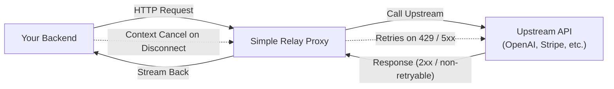
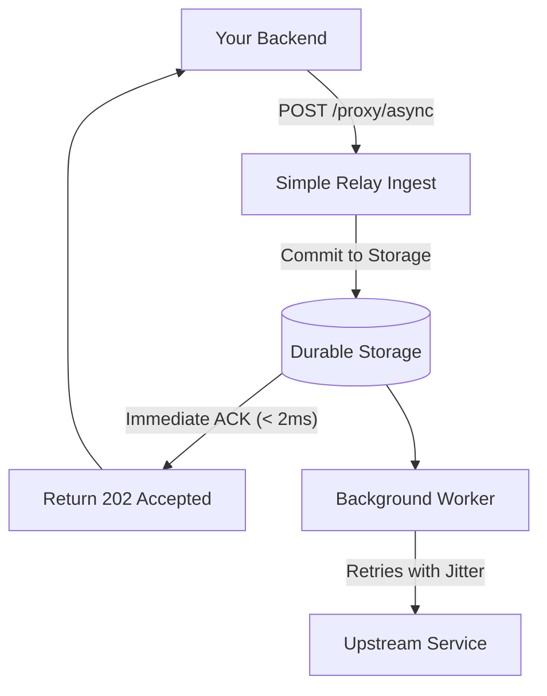

Simple Relay provides two operational modes for handling outgoing HTTP requests to external third-party APIs and downstream services:

1. **Synchronous Transparent Proxy (`/api/v1/proxy/sync`)**
2. **Asynchronous Background Relay (`/api/v1/proxy/async`)**

---

## 1. Synchronous Transparent Proxy

Use the synchronous proxy when your application makes an outbound request to an external service and needs the response immediately to complete the current HTTP lifecycle, but wants resilience against transient network blips and rate limits.

### Request Flow



### Usage Example

```bash
curl -X POST "http://localhost:8080/api/v1/proxy/sync?url=https://api.upstream.com/v1/charges" \
  -H "Authorization: Bearer sec_key_123" \
  -H "Content-Type: application/json" \
  -d '{"amount": 2000, "customer": "cus_123"}'
```

### Automatic 429 & 5xx Retries with `Retry-After` Support

When upstream responds with:
- `429 Too Many Requests`
- `502 Bad Gateway`, `503 Service Unavailable`, `504 Gateway Timeout`

Simple Relay intercepts the status code, inspects `Retry-After` headers (both integer seconds and RFC1123 HTTP dates), applies uniform full jitter, and retries the upstream request. Once upstream responds with `2xx` or non-retryable `4xx`, Simple Relay streams the response directly back to the caller.

### Client Disconnect Cancellation (Zero Wasted Compute)

> **Critical Safety Mechanism:** If your calling client closes its TCP connection, times out, or navigates away before Simple Relay finishes proxying, Simple Relay immediately triggers a Go context cancellation (`r.Context()`).

In-flight upstream requests are aborted instantaneously, and any scheduled retries are canceled. This prevents:
- Burning external API quotas when users have already left the page.
- Accumulating orphan worker goroutines during traffic spikes.

---

## 2. Asynchronous Background Relay

Use the asynchronous mode for fire-and-forget requests (sending emails, audit logs, analytics events, telemetry).

### Request Flow



### Usage Example

```bash
curl -X POST "http://localhost:8080/api/v1/proxy/async?url=https://api.resend.com/emails" \
  -H "Authorization: Bearer re_123" \
  -H "Content-Type: application/json" \
  -d '{"from": "noreply@app.com", "to": "user@gmail.com", "subject": "Welcome!"}'
```

Response:
```http
HTTP/1.1 202 Accepted
Content-Type: application/json

{"status":"accepted","request_id":"01j9x0z87q0000000000000000"}
```

The request returns in under 2 milliseconds. The payload is guaranteed to be delivered at-least-once according to your configured retry and backoff policy.

---

## Next Steps

- Explore how **[Retries and the Dead Letter Queue](/docs/retries-and-dlq)** handle persistent upstream outages.
- Read the **[Rate Limits and 429 Recipe](/docs/rate-limits-429)**.
